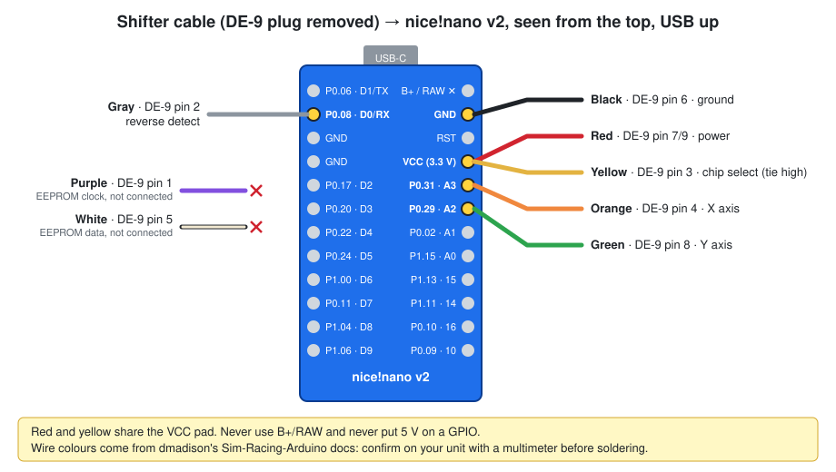

# Logitech Shifter → USB

Turn the **Logitech Driving Force Shifter** (the H-pattern shifter sold for the G29 / G920 / G923 wheels)
into a stand-alone **USB game controller** with a **nice!nano v2** board. No wheel needed.

# This mod's code is created by Claude. I use on my unit and it does work flawlessly. 

Windows shows it as **"H-Pattern Shifter"**: a joystick with 7 buttons.

| Button | 1 | 2 | 3 | 4 | 5 | 6 | 7 | none |
|---|---|---|---|---|---|---|---|---|
| Gear | 1st | 2nd | 3rd | 4th | 5th | 6th | Reverse | Neutral |

It deliberately has **no axes**, so a game can't grab the shifter by mistake when you bind pedals or a wheel.

- [What you need](#what-you-need)
- [1. Wire it](#1-wire-it)
- [Shortcut: prebuilt firmware](#shortcut-prebuilt-firmware) (no toolchain needed)
- [2. Install the toolchain](#2-install-the-toolchain)
- [3. Check the board's power switch (VccProbe)](#3-check-the-boards-power-switch-vccprobe)
- [4. Check the wiring and calibrate (ShifterTest)](#4-check-the-wiring-and-calibrate-shiftertest)
- [5. Flash the real firmware (ShifterHID)](#5-flash-the-real-firmware-shifterhid)
- [6. Use it in games](#6-use-it-in-games)
- [Troubleshooting](#troubleshooting)
- [How it works](#how-it-works)

---

## What you need

| Part | Notes |
|---|---|
| Logitech Driving Force Shifter | Board inside reads "Shifter Board 210-001489 Rev.006" on the unit this was built from |
| nice!nano v2 (or clone) | Any nRF52840 Pro-Micro-shaped board with the **Adafruit UF2 bootloader** and **SoftDevice S140 6.1.1** |
| USB-C data cable | |
| Soldering iron, multimeter, heat-shrink | The DE-9 plug is cut off and the wires soldered to the board |
| Windows PC | The helper scripts are PowerShell. macOS/Linux: see [Other operating systems](#other-operating-systems) |

**Check the bootloader first.** Plug the nice!nano in and double-tap its reset button (or briefly bridge RST to GND twice).
A drive called **NICENANO** appears. Open `INFO_UF2.TXT` and check for:

```
Board-ID: nRF52840-nicenano
SoftDevice: S140 version 6.1.1
```

The unit this was built on had *UF2 Bootloader 0.6.0, SoftDevice S140 6.1.1*.

## 1. Wire it



| Wire colour | DE-9 pin | Function | nice!nano pad | GPIO |
|---|---|---|---|---|
| Red | 7 / 9 | Power | **VCC** (3.3 V) | - |
| Yellow | 3 | Chip select (must be tied high) | **VCC** (same pad as red) | - |
| Black | 6 | Ground | **GND** | - |
| Orange | 4 | X axis (potentiometer wiper) | **A3** | P0.31 |
| Green | 8 | Y axis (potentiometer wiper) | **A2** | P0.29 |
| Gray | 2 | Reverse detect (buffered digital) | **D0 / RX** (2nd pad on the left) | P0.08 |
| Purple | 1 | EEPROM clock | not connected | - |
| White / cream | 5 | EEPROM data | not connected | - |

- Wire colours are from [dmadison's Sim-Racing-Arduino docs](https://dmadison.github.io/Sim-Racing-Arduino/docs/logitech_shifter.html).
  **Confirm them with a multimeter on your unit** before soldering: continuity from each wire to the DE-9 pin.
- The shifter electronics run happily on 3.3 V. **Do not use the B+/RAW pad**, and never put 5 V on any nRF52840 pin.
- X and Y must go to analog-capable pins (P0.02, P0.29, P0.31 on the Pro Micro footprint). **A0 (P1.15) is not analog** on the nRF52840.
- If you use different pads, change the `PIN_*` constants at the top of each sketch. The sketches use raw GPIO numbers:
  P0.n = `n`, P1.n = `32 + n`.

Safety: if anything gets warm or looks shorted, unplug immediately.

## Shortcut: prebuilt firmware

If you wired it **exactly as above**, you can skip steps 2-4 and flash a ready-made file. Copying a file works on Windows, macOS and Linux.

1. From the [latest release](https://github.com/KuekAn/logitech-shifter-usb/releases/latest), download the `.uf2` that matches how your board switches VCC (see [step 3](#3-check-the-boards-power-switch-vccprobe)):

   | File | Board |
   |---|---|
   | `ShifterHID-<version>-vcc-high.uf2` | Clones where VCC is on when P0.13 is HIGH. This is the board the mod was built and tested on |
   | `ShifterHID-<version>-vcc-low.uf2` | Genuine nice!nano v2, where VCC is on when P0.13 is LOW |

   Not sure which you have? Just try one. Picking the wrong one doesn't harm anything. The shifter just gets no power, and Windows shows
   **button 2 held down all the time**: with no power, both axes read 0, which the firmware treats as 2nd gear. If that happens, flash the other file.
2. Double-tap reset. When the **NICENANO** drive appears, copy the `.uf2` onto it.
   The drive closes by itself (Windows may warn that the copy was interrupted; that's normal), and the board restarts as **"H-Pattern Shifter"**.
3. Check it in `joy.cpl` as described in [step 5](#5-flash-the-real-firmware-shifterhid).

The gear thresholds in the prebuilt firmware come from the original unit. If gears are mis-detected or flicker on yours,
follow steps 2-5 to calibrate and build your own. The release also includes `-dfu.zip` files for `adafruit-nrfutil` and the raw `.hex` files.

## 2. Install the toolchain

Clone this repository, open PowerShell in it, then run:

```powershell
powershell -ExecutionPolicy Bypass -File tools\setup.ps1
```

This installs `arduino-cli` (via winget) and the **Adafruit nRF52 core 1.7.0**, the version this mod was tested with.
It doesn't change any existing Arduino IDE settings. At the end it lists the board `nicenano:nrf52:nicenano`,
which is defined in this repository (see [How it works](#how-it-works)).

All later commands use `tools\flash.ps1`, which builds a sketch and flashes it. It finds the board by itself:
- if the board runs one of these sketches, the script resets it into the bootloader;
- if the board is new or unknown, double-tap reset first so the NICENANO drive shows, then run the script.

## 3. Check the board's power switch (VccProbe)

The nice!nano can switch its **VCC pad** on and off with GPIO P0.13, and the shifter is powered from that pad.
On a genuine nice!nano, VCC is on when P0.13 is **LOW**. On the clone this mod was built on, it is on when P0.13 is **HIGH**.
If this is wrong, the shifter gets no power and every reading is 0, which looks exactly like broken wiring.

```powershell
powershell -ExecutionPolicy Bypass -File tools\flash.ps1 -Sketch VccProbe
powershell -ExecutionPolicy Bypass -File tools\capture.ps1 -Seconds 8
```

Output is `time,p013,x,y`. Leave the stick in neutral:

```
1.9,1,446,422    <- p013 = 1: shifter powered, readings ~400-500
...
3.9,0,0,0        <- p013 = 0: no power
```

Set `EXT_VCC_ON` in [`hardware/nicenano/nrf52/variants/nicenano/variant.h`](hardware/nicenano/nrf52/variants/nicenano/variant.h)
to the level that gave non-zero readings (`1` as shipped, `0` for a genuine nice!nano).

## 4. Check the wiring and calibrate (ShifterTest)

```powershell
powershell -ExecutionPolicy Bypass -File tools\flash.ps1 -Sketch ShifterTest
powershell -ExecutionPolicy Bypass -File tools\capture.ps1 -Seconds 60 -OutFile calibration\my-gears.csv
```

Output is `time,x,y,rev_pullup,rev_pulldown` at 10 Hz (`x`, `y`: 0-1023 = 0-3.3 V).
While it records, go through every gear slowly, holding each for a few seconds:
N → 1 → N → 2 → N → 3 → N → 4 → N → 5 → N → 6 → N → R → N.

What to look for:
- **X** changes left/right (low = left), **Y** changes up/down (high = up), both smoothly. If they're swapped or don't move,
  the wire colours differ on your unit: find the wipers with a multimeter.
- **Reverse**: both reverse columns are `0` normally and `1` only with the stick pushed down into R.
  If `rev_pullup` is `1` and `rev_pulldown` is `0`, the gray wire isn't connected.

The values from the unit this was built on ([calibration/gears-2026-10-31.csv](calibration/gears-2026-10-31.csv)):

| Gear | X | Y | Reverse |
|---|---|---|---|
| N | 436-470 | 412-452 | 0 |
| 1 | 156-183 | 818-918 | 0 |
| 2 | 175-217 | 0-94 | 0 |
| 3 | 423-428 | 1014 | 0 |
| 4 | 436-445 | 0-45 | 0 |
| 5 | 673-769 | 761-968 | 0 |
| 6 | 678-735 | 0-48 | 0 |
| R | 725-742 | 0-52 | 1 |

If yours differ, edit the thresholds at the top of [`ShifterHID/ShifterHID.ino`](ShifterHID/ShifterHID.ino).
Put each threshold roughly halfway between the neutral range and a gear range:

```cpp
const int X_LEFT_MAX  = 300;     // x below this: gears 1/2
const int X_RIGHT_MIN = 590;     // x above this: gears 5/6/R
const int Y_UP_ENGAGE    = 650;  // enter an upper gear (1/3/5)
const int Y_UP_RELEASE   = 600;  // fall back to neutral
const int Y_DOWN_ENGAGE  = 230;  // enter a lower gear (2/4/6/R)
const int Y_DOWN_RELEASE = 280;
```

The gap between `ENGAGE` and `RELEASE` is hysteresis: it stops the gear flickering when the stick sits near the edge of a slot.

## 5. Flash the real firmware (ShifterHID)

```powershell
powershell -ExecutionPolicy Bypass -File tools\flash.ps1 -Sketch ShifterHID
```

Check it in Windows:
- **Win+R → `joy.cpl`**: "H-Pattern Shifter" is listed. Open **Properties** and shift: buttons 1-7 light up.
- Or from the terminal, logging each gear change as Windows sees it:
  ```powershell
  powershell -ExecutionPolicy Bypass -File tools\joytest.ps1 -Seconds 30
  ```

ShifterHID keeps a USB serial port, so `capture.ps1` still works. It prints `x,y,reverse,gear` for re-tuning,
and `flash.ps1` can update the board without touching the reset button.

## 6. Use it in games

In the game's controls, pick the H-pattern / "H-shifter" option and bind gears 1-6 and R to buttons 1-7.
Neutral is "no button pressed", which is what games expect from a button-based H-shifter.

**Reverse:** push the stick **down first**, then move it into the bottom-right slot. If you go into 6th and push down
afterwards, the game sees 6th for a moment before R.

**Several DIY controllers:** the board uses USB ID `1209:0001`, a [pid.codes](https://pid.codes/1209/0001/) test ID.
It can't collide with an Arduino Leonardo (`2341:8036`), which many DIY pedal boxes use. If you build two of these,
give the second one a different `build.pid` in
[`hardware/nicenano/nrf52/boards.txt`](hardware/nicenano/nrf52/boards.txt). That file also holds the name Windows shows (`usb_product`).

## Troubleshooting

| Symptom | Cause / fix |
|---|---|
| Prebuilt firmware: button 2 always on, nothing changes | Shifter unpowered: flash the other `vcc-*` `.uf2` ([details](#shortcut-prebuilt-firmware)) |
| All readings are 0 | Shifter unpowered: wrong `EXT_VCC_ON` (run [VccProbe](#3-check-the-boards-power-switch-vccprobe)), or red/black not on VCC/GND |
| X or Y stuck, jumps, or swapped | Wire colours differ on your unit, or a wiper is on a non-analog pad. Check with a multimeter |
| Reverse never registers | Gray wire loose (`rev_pullup`=1, `rev_pulldown`=0 in ShifterTest) or on another pad |
| Wrong gear or flickering | Recalibrate (step 4) and adjust the thresholds |
| `flash.ps1`: "no nice!nano found" | Double-tap reset so the NICENANO drive appears, then run it again |
| `flash.ps1`: "Adafruit nRF52 core 1.7.0 not found" | Run `tools\setup.ps1` |
| "running scripts is disabled on this system" | Use `powershell -ExecutionPolicy Bypass -File ...` as shown above |
| Compile error `Adafruit_USBD_CDC.h: No such file` | Build through `flash.ps1`, which adds the flags the local board definition needs |
| Not in joy.cpl | Check Device Manager for "HID-compliant game controller" under `USB\VID_1209&PID_0001`; reflash ShifterHID |

## How it works

### Repository layout

```
ShifterHID/         the firmware: reads the stick, works out the gear, sends a 1-byte HID report on change
ShifterTest/        raw readout for wiring checks and calibration
VccProbe/           finds the VCC switch polarity
hardware/nicenano/  local board definition "nicenano:nrf52:nicenano" on top of adafruit:nrf52
tools/setup.ps1     installs arduino-cli + Adafruit nRF52 core 1.7.0
tools/flash.ps1     build + flash over the bootloader's serial DFU (adafruit-nrfutil)
tools/capture.ps1   logs the serial output to the screen / a CSV
tools/joytest.ps1   watches the buttons through the Windows joystick API (what joy.cpl uses)
tools/make-release.ps1  builds the release files (.uf2 / -dfu.zip / .hex, vcc-high and vcc-low)
calibration/        reference recording from the original build
docs/wiring.svg     wiring diagram
```

### Why a custom board definition

The Adafruit nRF52 core has no nice!nano board. Its closest match, the Nordic nRF52840 DK, maps pin numbers straight to GPIOs, which is useful.
But it assumes a 32 kHz crystal (not reliably fitted on clones) and drives P0.13-P0.16 as LEDs at boot. On the nice!nano, P0.13 is the VCC switch.
So [`hardware/nicenano`](hardware/nicenano) adds a small variant that:
- maps pin numbers 1:1 to GPIOs (P0.n = n, P1.n = 32 + n);
- uses the internal RC oscillator;
- drives the LED on P0.15;
- turns VCC on at boot (`EXT_VCC_ON`);
- sets the USB identity (`1209:0001`, "H-Pattern Shifter").

It reuses the Adafruit core, libraries and toolchain. Arduino can't find the core's bundled libraries through a referenced core,
so `flash.ps1` passes `--libraries` and `runtime.platform.path`.

Note: in this variant, `A0`..`A7` are the chip's AIN0..AIN7, **not** the Pro Micro silkscreen labels. The sketches use GPIO numbers.

### Gear logic

- **Columns:** X picks the column (left 1/2, middle 3/4, right 5/6/R).
- **Engaging:** Y beyond an engage threshold puts the shifter in a gear.
- **Releasing:** it stays in that gear until Y comes back past the release threshold.
- **Reverse:** reported only in the 6th slot with the reverse line high. A push-down anywhere else is ignored.
- **Sampling:** the ADC runs ratiometric to VDD (`AR_VDD4`), 10-bit, 8× oversampling, about once a millisecond. A report goes out only when the gear changes.

### Other operating systems

Untested, but the steps are the same. With the Adafruit core 1.7.0 installed and this repository as the working directory:

```sh
export ARDUINO_DIRECTORIES_USER="$PWD"
ADA=~/.arduino15/packages/adafruit/hardware/nrf52/1.7.0        # macOS: ~/Library/Arduino15/packages/...
arduino-cli compile -b nicenano:nrf52:nicenano --libraries "$ADA/libraries" \
  --build-property "runtime.platform.path=$ADA" --output-dir build/ShifterHID ShifterHID
adafruit-nrfutil dfu serial -pkg build/ShifterHID/ShifterHID.ino.zip -p /dev/ttyACM0 -b 115200 --singlebank
```

On macOS, `adafruit-nrfutil` ships with the core (`$ADA/tools/adafruit-nrfutil/macos/`). On Linux, install it with `pip install adafruit-nrfutil`.
Put the board in the bootloader first (double-tap reset) and use the bootloader's serial port.

## Credits

- Shifter pinout and wire colours: [dmadison/Sim-Racing-Arduino](https://github.com/dmadison/Sim-Racing-Arduino)
- [Adafruit nRF52 Arduino core](https://github.com/adafruit/Adafruit_nRF52_Arduino) and [Adafruit TinyUSB](https://github.com/adafruit/Adafruit_TinyUSB_Arduino)
- nice!nano pin map: [ZMK](https://github.com/zmkfirmware/zmk) `arduino_pro_micro_pins.dtsi`
- USB test ID: [pid.codes](https://pid.codes)

## License

MIT, see [LICENSE](LICENSE) and [NOTICE](NOTICE). The files in `hardware/nicenano/nrf52/variants/nicenano/` are adapted from the
Adafruit nRF52 core's pca10056 variant and remain under the **LGPL-2.1**, as noted in their headers.
